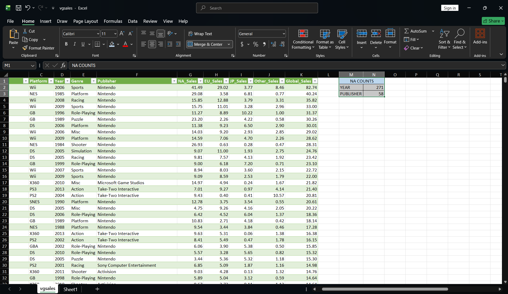
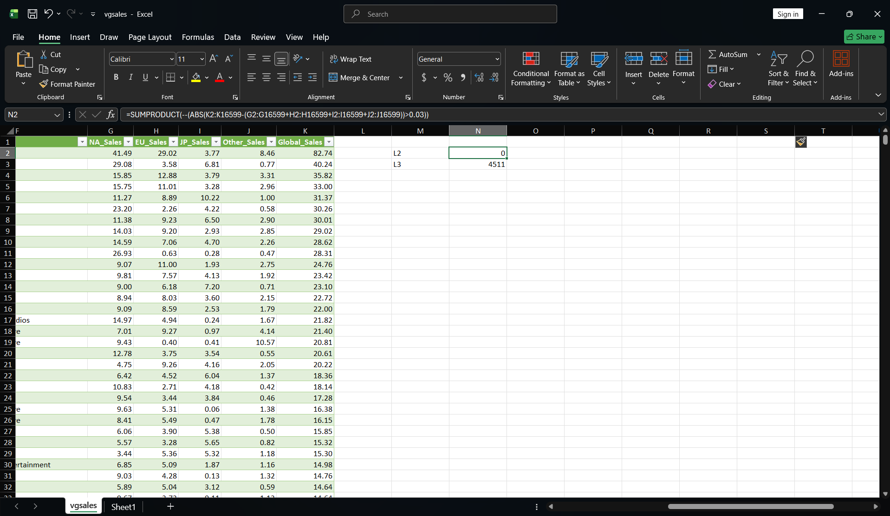
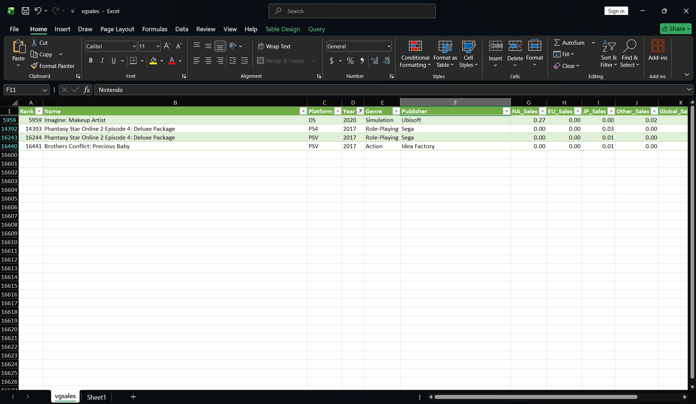
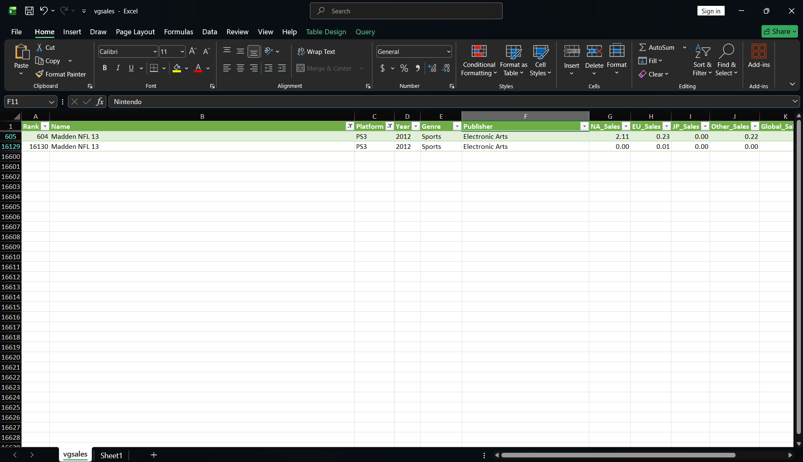

# Phase 0 exit test: vgsales

## Source
vgsales.csv by Gregory Smith on Kaggle ([[VIDEO GAME SALES](https://www.kaggle.com/datasets/gregorut/videogamesales)]). License: unknown, so the data is not in this repo. 16,598 rows, 11 columns. Sales unit: in millions.

## Grain
One game on one platform, with its release year and its regional and global sales (lifetime totals, not per year). Key: Name + Platform + Year. The file has 11,493 distinct names in 16,598 rows because a game appears once per platform.

## Quality problems
| Problem | Count | Why it matters |
|---|---|---|
| Year holds the text "N/A" | 271 rows | Year trends skip these rows. Blank years also block duplicate matching. |
| Publisher holds the text "N/A" | 58 rows | Publisher totals include an "N/A" group. |
| Years later than the rest of the file (2017: 3 rows, 2020: 1 row) | 4 rows, 3 games | Flagged. The file does not say whether they are planned releases or errors. |
| Duplicate on Name + Platform + Year | 2 extra rows | One is a true duplicate (Wii de Asobu: Metroid Prime, identical rows, blank year). The other is a conflict (Madden NFL 13, PS3, 2012: Global 2.56 vs 0.01). |
| Same name and platform, different year | Need for Speed: Most Wanted (PC, X360) | Different games (2005 and 2012). Name + Platform alone would wrongly call them duplicates. |
| Blank year hides a possible duplicate | Sonic the Hedgehog, PS3 | One row from 2006 and one with a blank year and different sales. |
| Name repeats across rows | 7,880 rows, 2,775 names, 5,105 extra rows | Same game on different platforms. Not an error. |
| Names starting with a dot | 10 rows (".hack") | A leading dot affects sorting and some tools. |
| Global_Sales differs from the sum of the four regions | Total 8,920.44 vs 8,915.85 | Rounding to 2 decimals. Largest row difference 0.02, no row above 0.03, 4,511 rows differ slightly. Not an error. |
| Regions all 0, Global above 0 | 1 row (Rank 16598) | Same rounding effect. |
| Rank is unique but runs to 16,600 | 2 numbers missing | Rank is a sales rank, not a stable ID. |
| Global_Sales = 0.01 | 618 rows (435 games) | 0.01 is the smallest value in the file, so smaller sales can't be seen. |

## Three questions the data can answer
1. Which platform sold the most units worldwide? (Platform, Global_Sales) PS2, 1,255.64.
2. Which genre sells the most and the least? (Genre, Global_Sales) Action 1,751.18; Strategy 175.12.
3. Which publisher sold the most? (Publisher, Global_Sales) Nintendo 1,786.56. The 58 "N/A" rows are one group.

## One question it cannot answer
How much money the games earned. The file has units only, with no price or revenue.

## Decisions and limits
- Nothing was removed or changed. All counts are from the original file.
- Would remove: the identical Metroid Prime duplicate.
- Flag only: the Madden conflict, the Sonic blank-year row, the 4 late years, the 271 blank years and the 58 "N/A" publishers.
- Keep Global_Sales as given. The gap to the sum of regions is rounding, so replacing it would change the source data.
- Don't trend by year without excluding blank and late years.
- Limit: with no row ID, I can't prove which row of a conflict is the correct one.

## Screenshots
**271 "N/A" years and 58 "N/A" publishers**

**Global_Sales vs sum of regions: 0 rows above 0.03 (rounding only)**

**The 4 rows with a year after 2016**

**Madden NFL 13 (PS3, 2012): two rows with different sales**
