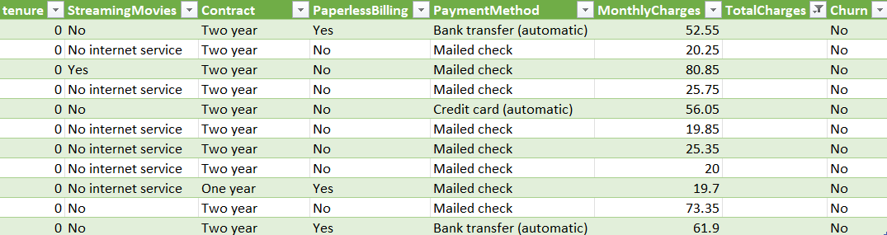
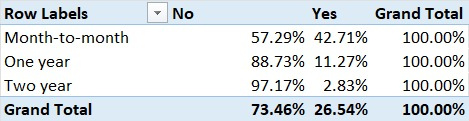

# Task 01: Telco Customer Churn

**Phase 0 · Excel · Beginner**

## Question
Which customers leave, and how does contract type relate to churn?

## Source
Kaggle: [Telco Customer Churn](https://www.kaggle.com/datasets/blastchar/telco-customer-churn/data) (`WA_Fn-UseC_-Telco-Customer-Churn.csv`), downloaded 18 Oct 2026.
License as shown on Kaggle: "Data files © Original Authors". Reuse terms are not stated, so the raw data is not included in this repo. Download it from the link above.
The Kaggle data card defines `Churn` as customers who left within the last month (values Yes or No).

## Grain
One row = one customer. The file has 7,043 rows and 21 columns. Kaggle's data card reports 7,043 unique `customerID` values, which matches the row count.

## Quality problems
- **11 rows have a blank `TotalCharges`.** All 11 have `tenure = 0` and `Churn = No`. They are most likely new customers who have not been billed yet, which fits with them not having left. An `ISNUMBER` test on a blank cell returned FALSE, so Excel does not treat these cells as numbers. A `LEN` test returned 0, so these cells are truly empty rather than holding a space.
- **`TotalCharges` shows inconsistent decimals** (for example 1889.5 vs 1889.50). Excel hides trailing zeros, so this affects display only. This column was not used in any calculation in this task.

## Method
Worked on a copy of the raw file in Excel; the raw file was not edited. Built pivot tables on `Churn` and `Contract`, using "Show Values As % of Row Total" to compare rates. Filtered `TotalCharges` to its blank entries to isolate the 11 rows. No `TotalCharges` calculations were done, so all 7,043 rows are included in every count and rate below.

## Findings
1. **Overall churn:** 1,869 of 7,043 customers left, a churn rate of **26.54%** (5,174 stayed).
2. **Churn by contract type:**

| Contract | Customers | Churned | Churn rate |
|---|---|---|---|
| Month-to-month | 3,875 | 1,655 | 42.71% |
| One year | 1,473 | 166 | 11.27% |
| Two year | 1,695 | 48 | 2.83% |

3. **Month-to-month customers account for 1,655 of the 1,869 churners (88.55%).** This is the most common contract and also the one with the highest churn rate, so it holds almost nine in ten of all churned customers.

## What the data can't answer
- **Why customers left.** There is no column recording a reason for leaving.
- **Whether contract type causes churn.** The data shows the two move together, not that one produces the other. For example, customers already planning to leave may simply choose flexible contracts.