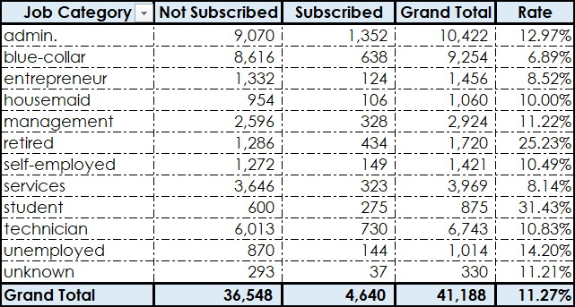
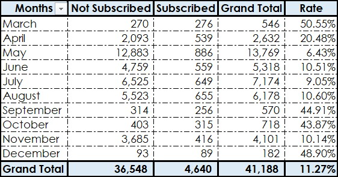
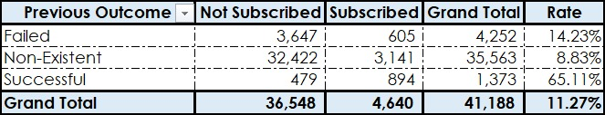
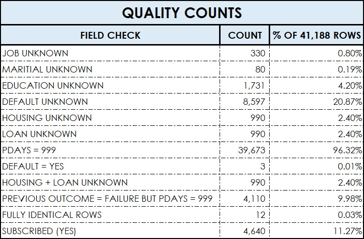
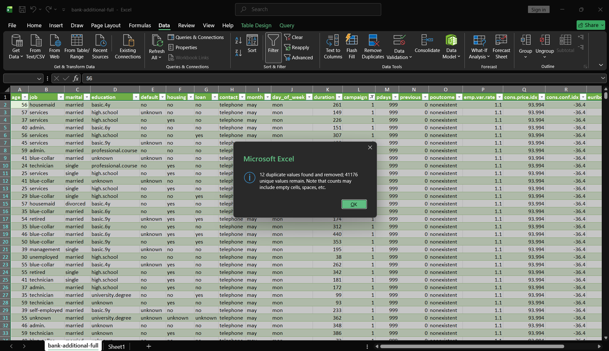

# Bank Marketing Analysis (Excel)

## Question
What share of bank phone calls ended in a term-deposit subscription, and how does this differ by job, month of contact and previous campaign outcome?

## Source
- UCI Machine Learning Repository, Bank Marketing: https://archive.ics.uci.edu/dataset/222/bank%2Bmarketing
- File used: `bank-additional-full.csv`, 41,188 rows, 21 columns, semicolon-delimited.
- Phone marketing campaigns of a Portuguese bank. UCI documents the collection period as May 2008 to November 2010.
- Target column `y`: whether the customer subscribed to a term deposit (yes/no).
- The raw CSV and the Excel workbook are not included in this repository.

## Grain
One row = one phone contact, not necessarily one unique customer. There is no client ID, so unique customers cannot be counted and every rate below is per call, not per customer.

## Method
- Excel only. No predictive model, no causal claims.
- `COUNTIF` and `COUNTIFS` for quality counts, Remove Duplicates to check identical rows.
- PivotTables for subscription rate by job, month and previous outcome, all on the full 41,188 rows.
- Rate = subscribed contacts / total contacts in the group x 100.
- In the PivotTables I renamed the display labels `failure`, `nonexistent` and `success` to Failed, Non-Existent and Successful.

## Overall result
- 41,188 contacts, 4,640 subscribed, 36,548 not subscribed.
- Overall subscription rate: 11.27%. This is the baseline for comparing groups.

## Findings

### By job

- Highest: students 31.43% (875 contacts), retired 25.23% (1,720 contacts), unemployed 14.20% (1,014).
- Lowest: blue-collar 6.89% (9,254 contacts), services 8.14% (3,969), entrepreneur 8.52% (1,456).
- Unknown job: 11.21% (330 contacts), close to the baseline, so these rows do not distort the comparison.
- Job categories differ clearly, but this does not show that occupation caused the difference. Group sizes also differ a lot.

### By month

- May: 6.43% from 13,769 contacts, about one-third of the file and the lowest rate.
- March 50.55% (546 contacts), September 44.91% (570), October 43.87% (718), December 48.90% (182). Combined: 2,016 contacts (4.9% of all) and 936 subscriptions (20.2% of all).
- June, July, August and November: between 9.05% and 10.60%. April: 20.48% (2,632 contacts).
- January and February are not in the data.
- The high-rate months have few contacts, and there is no year column, so each month may combine several years. This does not show which month is best for a future campaign.

### By previous campaign outcome

- Successful: 65.11% (1,373 contacts). These contacts produced 894 of the 4,640 subscriptions (19.3%).
- Failed: 14.23% (4,252 contacts).
- Non-Existent: 8.83% (35,563 contacts).
- Previous outcome is associated with the result, but this does not show that an earlier success caused a later subscription.
- 4,110 of the 4,252 Failed rows (96.7%) have `pdays = 999`, so the Failed rate depends on the contradiction described below.

## Data quality

| Check | Count | % of rows |
|---|---:|---:|
| Job unknown | 330 | 0.80% |
| Marital unknown | 80 | 0.19% |
| Education unknown | 1,731 | 4.20% |
| Default unknown | 8,597 | 20.87% |
| Housing unknown | 990 | 2.40% |
| Loan unknown | 990 | 2.40% |
| `pdays = 999` | 39,673 | 96.32% |
| Default = yes | 3 | 0.01% |
| Housing and loan both unknown | 990 | 2.40% |
| Previous outcome = failure but `pdays = 999` | 4,110 | 9.98% |
| Fully identical rows | 12 | 0.03% |
| Subscribed = yes (baseline, not a quality problem) | 4,640 | 11.27% |

- **`pdays = 999`** is a code for "not previously contacted", not 999 days. It must not be averaged or used as a number.
- **`pdays` and `poutcome` contradict each other.** Non-Existent (35,563) plus the 4,110 failure rows with `pdays = 999` gives exactly 39,673. The file does not say which column is right, so neither is a reliable "previously contacted" flag on its own.
- **`default`:** 20.87% unknown and only 3 rows say yes, so the column carries almost no information.
- **`housing` and `loan`:** the same 990 rows are missing both, so this is 990 affected rows, not 1,980.
- **12 identical rows** found with Remove Duplicates (41,176 remain). I kept all 41,188 rows, because without an ID I cannot tell repeat calls from duplicate entries.

- **`duration`** (call length) is only known after the call, per the UCI documentation. It would be leakage in a prediction model. It is not used in this analysis.

## What the data cannot answer
- Campaign profitability: there is no cost or revenue data.
- Number of unique customers who subscribed: there is no client ID.
- Why rates differ: only associations are shown.
- Trends by year, or the best month for a future campaign: there is no year column and the high-rate months have few contacts.
- January and February: not in the data.
- Whether the results hold today: the data covers 2008 to 2010.

## Files
- `screenshots/`: Remove Duplicates result, quality table and the three PivotTables

## Reference
Moro, S., Rita, P., & Cortez, P. (2014). Bank Marketing. UCI Machine Learning Repository. https://doi.org/10.24432/C5K306