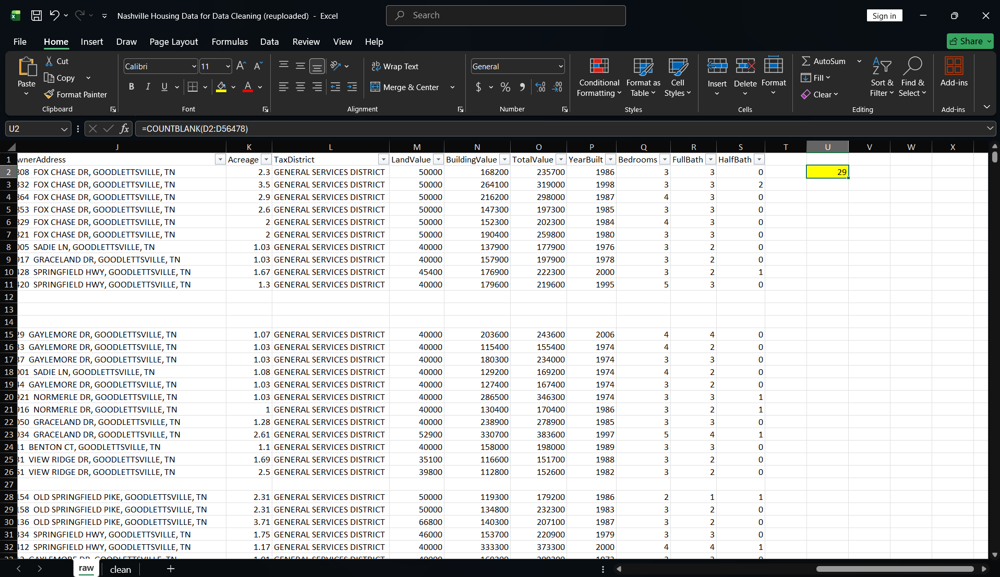
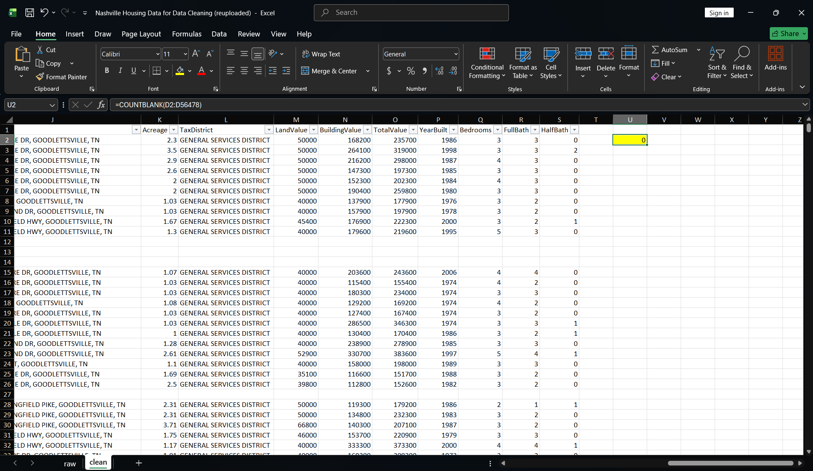
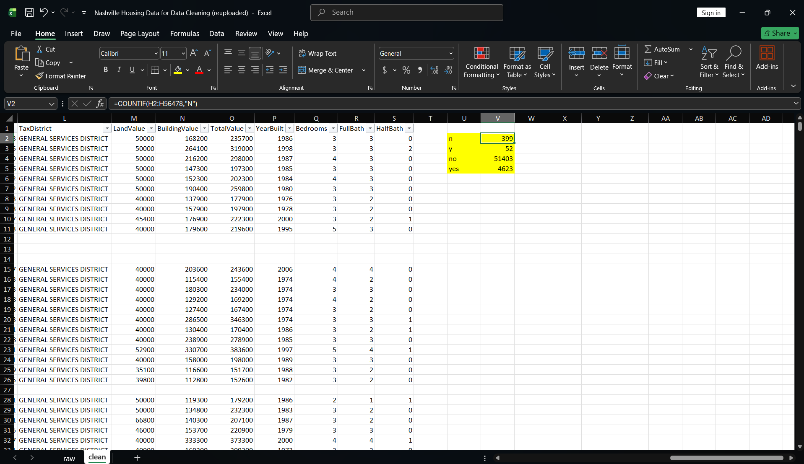
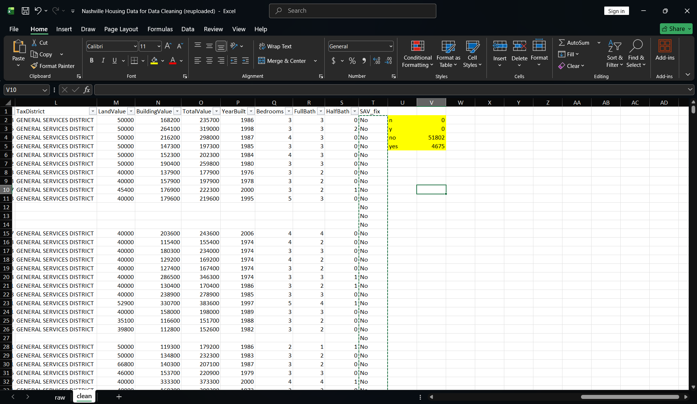
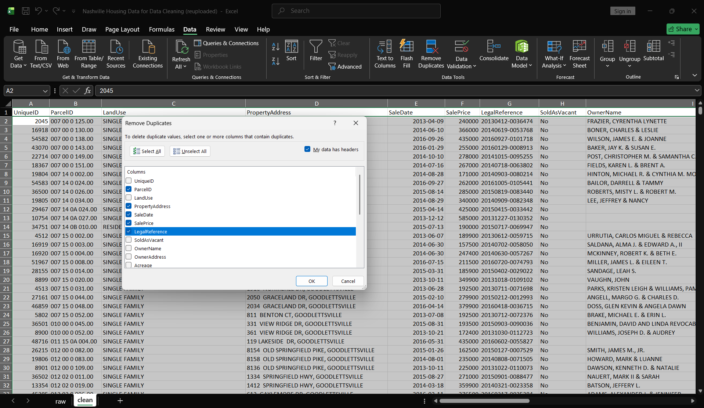
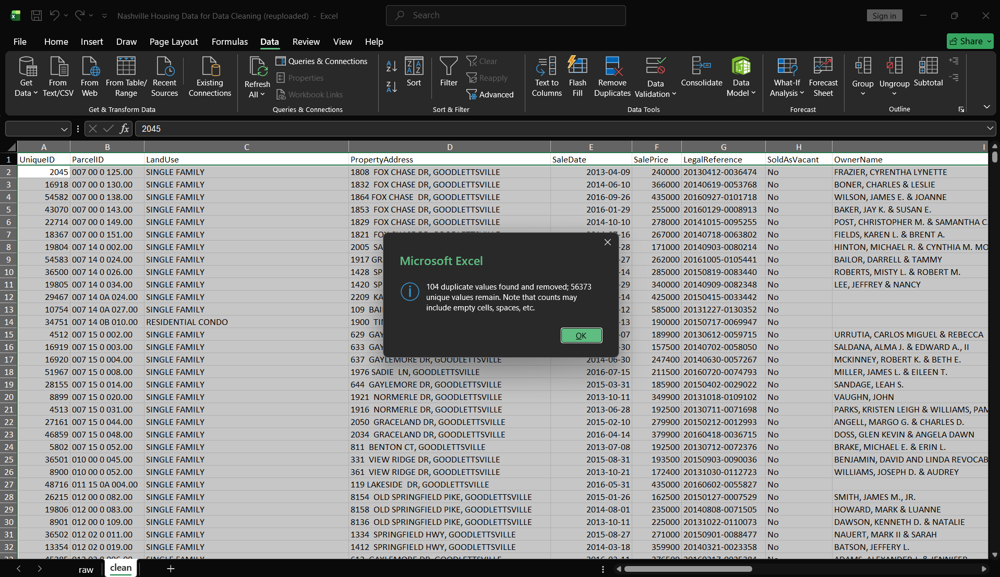
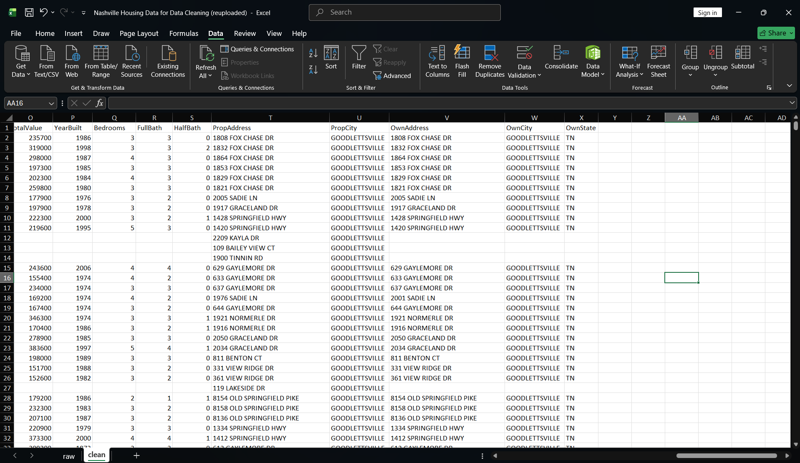

# Task 03: Nashville Housing data cleaning (Excel)

## Question

Can this sales file be counted and grouped by property, city, date and vacancy status without wrong totals? What has to be fixed first?

## Source

"Nashville Housing Data for Data Cleaning (reuploaded).xlsx" from the [AlexTheAnalyst/PortfolioProjects](https://github.com/AlexTheAnalyst/PortfolioProjects) repository on GitHub. 56,477 rows, 19 columns. Tool: desktop Excel. The original is unchanged on the `raw` sheet. All changes are on the `clean` sheet.

## Grain

One row per recorded property sale. The same ParcelID can appear more than once because a property can be sold more than once. The same LegalReference can appear for several properties because one deed can cover several parcels. So repeated ParcelID (15,143 rows) and repeated LegalReference (5,022 rows) are not duplicates.

## Quality problems

| Problem | Count | Action |
|---|---:|---|
| Blank PropertyAddress | 29 | Filled from another sale with the same ParcelID. 0 left. |
| SoldAsVacant used N, Y, No, Yes | 399 N, 52 Y (451 rows) | Standardized to No/Yes. |
| Address in one cell (property, owner) | 2 columns | Split into street, city, state: 5 new columns. |
| Duplicate sales | 104 rows | Removed (rule below). |
| UniqueID header had a trailing space | 1 | Retyped. LEN = 8. |
| OwnerAddress blank | 30,462 rows | Not fixable. Left blank. |
| PropCity = UNKNOWN | 1 row | Kept and documented. |

## Method

1. Kept the original on `raw`. Worked on a copy named `clean`.
2. Blank addresses: helper column with `=IF(D2<>"",D2,XLOOKUP(1,($B$2:$B$56478=B2)*($D$2:$D$56478<>""),$D$2:$D$56478,"NOT FOUND"))`, then pasted as values. Check: `COUNTBLANK` went from 29 to 0. My first lookup returned the wrong address for 2 of the 29 because the first matching row was itself blank. The not-blank condition fixed it.
3. SoldAsVacant: helper column `=IF(H2="Y","Yes",IF(H2="N","No",H2))`, pasted as values. Check: COUNTIF before N 399, Y 52, No 51,403, Yes 4,623. After: N 0, Y 0, No 51,802, Yes 4,675. Both add up to 56,477.
4. Addresses: Text to Columns (comma) on copies, then TRIM. Check: the street in PropertyAddress compared with PropAddress on every row: 0 mismatches. The city and owner columns were not compared.
5. Duplicates: Remove Duplicates on ParcelID, PropertyAddress, SalePrice, SaleDate, LegalReference. UniqueID was not included because it is different on every row. Done after the address fill, because the fill created one more duplicate (104, not 103). Excel reported 104 removed, 56,373 remaining.
6. Header: retyped UniqueID.

## Findings

- 56,477 rows became 56,373. The sheet has 24 columns (19 original + 5 address).
- 0 blank PropertyAddress.
- The 104 removed rows differed from the kept row only in UniqueID (one pair also in LandUse).
- The No/Yes counts above are before duplicate removal.

## What the data can't answer

- Who owned the property in the 30,462 sales with no OwnerAddress. Nothing in the file fills it.
- Whether the owner lived at the property. OwnerAddress sometimes differs from PropertyAddress (for example 1976 SADIE LN and 2001 SADIE LN), and there is no occupancy field.
- Whether the 104 removed rows were data-entry duplicates or separate records. They matched on five fields; the file has no entry source.
- Why the price changed between sales of the same property.

## Screenshots

The screenshots below document the cleaning process and validation results.

## Screenshots
**Blank PropertyAddress: 29 before, 0 after**

**SoldAsVacant: N, Y, No, Yes before; No, Yes after**

**Remove Duplicates: five columns ticked, 104 removed, 56,373 remain**

**Final clean sheet with the split address columns**

## Files

- `screenshots/`: before-and-after cleaning evidence, duplicate-removal dialog and result, and the final worksheet.
