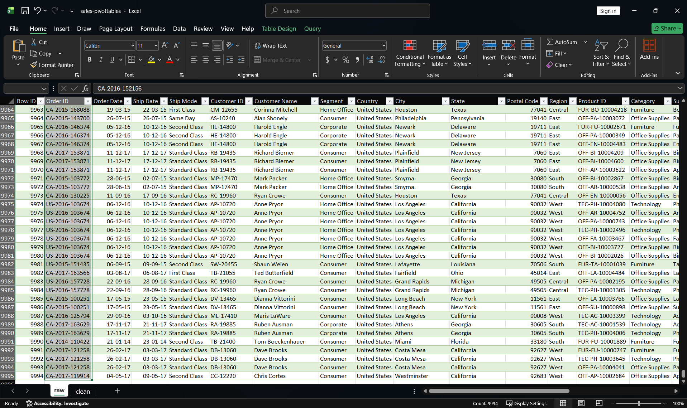
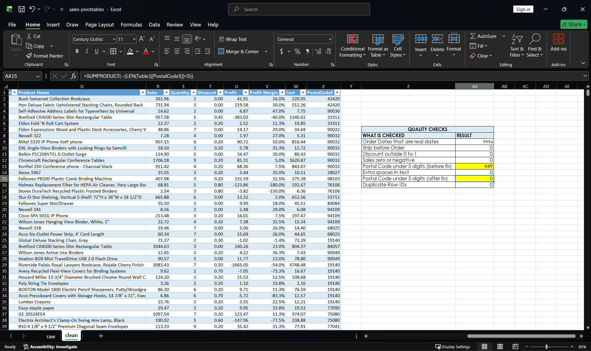
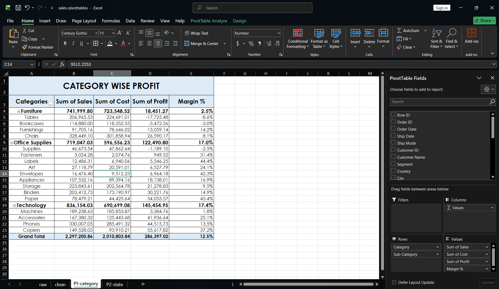
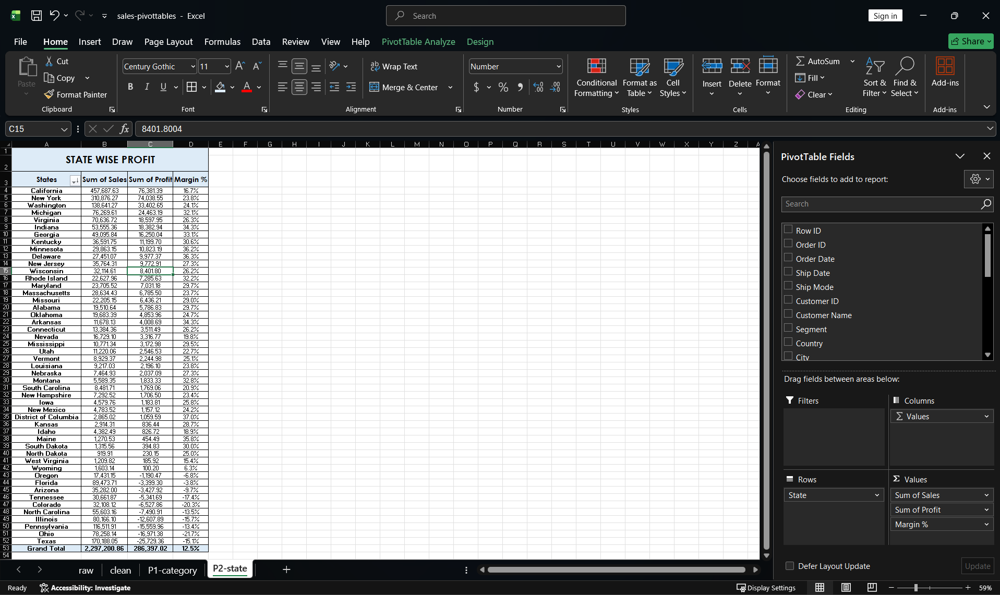
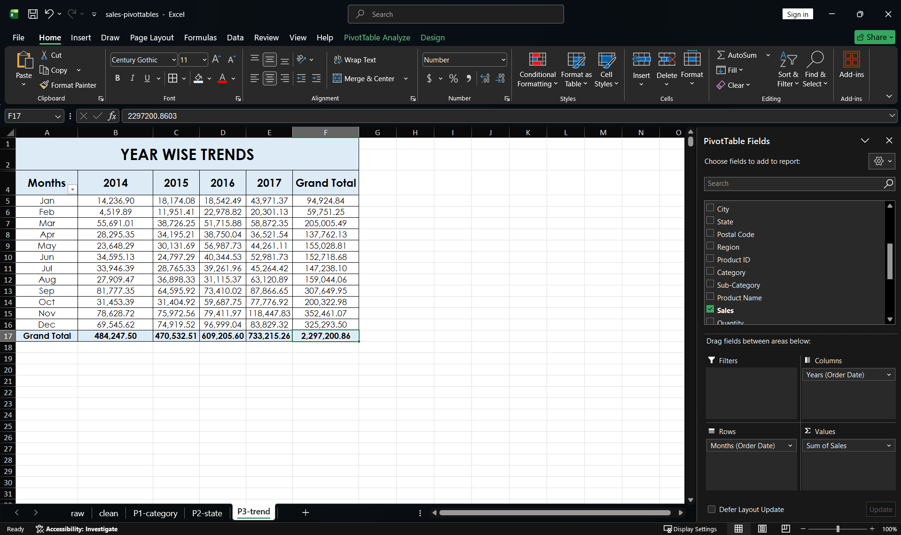
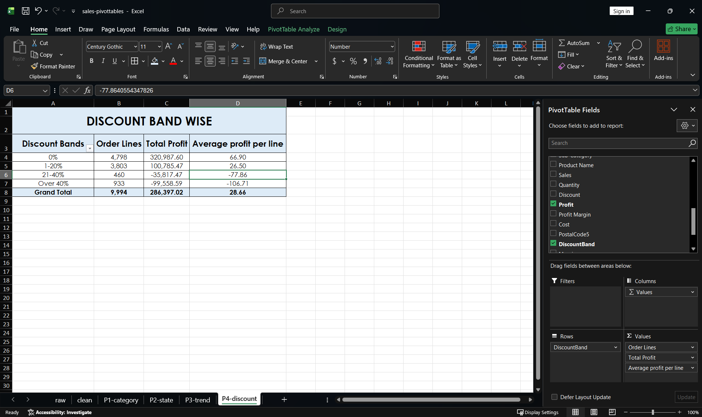

# Task 04: Sales Analysis with PivotTables

## Question
Which categories, states, months and discount levels make or lose money in this sales data?

## Source
Superstore Sales dataset (Kaggle): https://www.kaggle.com/datasets/vivek468/superstore-dataset-final. 9,994 rows, one row per product line in an order, order dates Jan 2014 to Dec 2017. The original CSV is kept in `datasets/raw` and is not committed.

## Grain
One row per product line within an order (Row ID). An Order ID can appear on several rows.

## Quality problems
Eight checks run on the `clean` sheet, all results in `02-quality-checks.png`:
- Blanks and NAs: 0.
- Order Date is a real date: 9,994 of 9,994.
- Ship Date before Order Date: 0.
- Discount outside 0 to 1: 0.
- Sales zero or negative: 0.
- Extra spaces in text: 0.
- Duplicate Row IDs: 0. Full-row duplicates (all columns except Row ID, checked on a scratch copy): 0.
- Postal Code: 449 of 9,994 rows (4.5%) had only 4 digits. Excel stored the code as a number and dropped the leading zero (1040 instead of 01040). Fixed in a new text column `PostalCode5` with `TEXT(...,"00000")`; the check after the fix returns 0.
- The data has no cost column. I derived Cost = Sales - Profit.

## Method
1. Copied `raw` to `clean` and made it an Excel Table. `raw` is untouched.
2. Added columns: Profit Margin, Cost, PostalCode5 and DiscountBand (0%, 1-20%, 21-40%, Over 40%; a discount of exactly 0.2 is in 1-20%, exactly 0.4 is in 21-40%).
3. Built four PivotTables from the Table: category and sub-category, state, month by year, discount band.
4. Margin % in the pivots is a Calculated Field (Profit / Sales), so it divides the totals instead of averaging row margins.

## Findings
Totals: sales 2,297,200.86, cost 2,010,803.84, profit 286,397.02, margin 12.5%.

- **Category.** 3 of 17 sub-categories lose money: Tables (-17,725.48, margin -8.6%), Bookcases (-3,472.56, -3.0%) and Supplies (-1,189.10, -2.5%). Furniture is about 32% of sales but about 6% of profit (margin 2.5%). Technology is about 36% of sales and about 51% of profit (margin 17.4%).
- **State.** California (76,381.39) and New York (74,038.55) make about 52% of total profit. 10 of 49 states lose money: Texas, Ohio, Pennsylvania, Illinois, North Carolina, Colorado, Tennessee, Arizona, Florida and Oregon. Together they have about 31% of sales and about -98,200 in profit. Texas is third by sales (170,188.05) and last by profit (-25,729.36).
- **Trend.** Sales by year: 2014 484,247.50; 2015 470,532.51 (down about 2.8%); 2016 609,205.60 (up about 29.5%); 2017 733,215.26 (up about 20.4%). September, November and December together are about 43% of all sales. November 2017 is the highest month (118,447.83).
- **Discount.** Lines with no discount: 4,798 lines, profit 320,987.60. 1-20%: 3,803 lines, profit 100,785.47. 21-40%: 460 lines, profit -35,817.47. Over 40%: 933 lines, profit -99,558.59. Lines with a discount above 20% are 1,393 of 9,994 (about 14%) and lost 135,376 in total.

## What the data can't answer
- Why a sub-category or state loses money. The discount result is an association; this data cannot show that discounts caused the losses.
- What is inside Cost (product, shipping, overhead) or how Profit was calculated. Cost here is derived.
- Why 2015 sales dipped, or why discounts were given.

## Files
- `work/sales-pivottables.xlsx`: sheets `raw`, `clean`, `P1-category`, `P2-state`, `P3-trend`, `P4-discount`.

## Screenshots

### 1. Raw data check
The `raw` sheet as imported: 9,994 rows, untouched.

### 2. Quality checks
Eight checks and their results, including the 449 short postal codes before the fix and 0 after.

### 3. Pivot 1: Category and Sub-Category
Sales, Cost, Profit and Margin %, with the loss-making sub-categories listed first in each category.

### 4. Pivot 2: State
Sales, Profit and Margin % by state, sorted by profit; 10 of 49 states lose money.

### 5. Pivot 3: Monthly trend
Sales by month for each year, 2014 to 2017.

### 6. Pivot 4: Discount bands
Order lines, total profit and average profit per line for each discount band.

