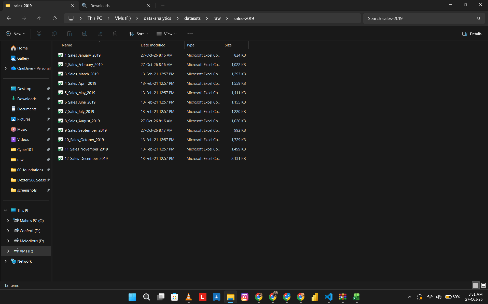
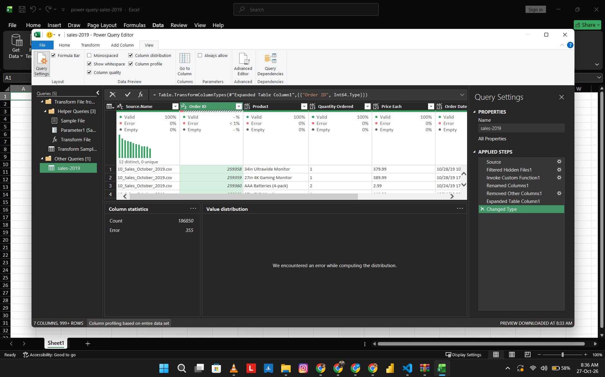
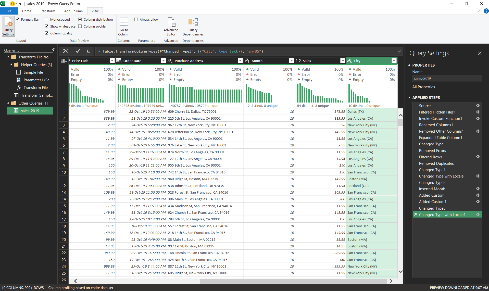
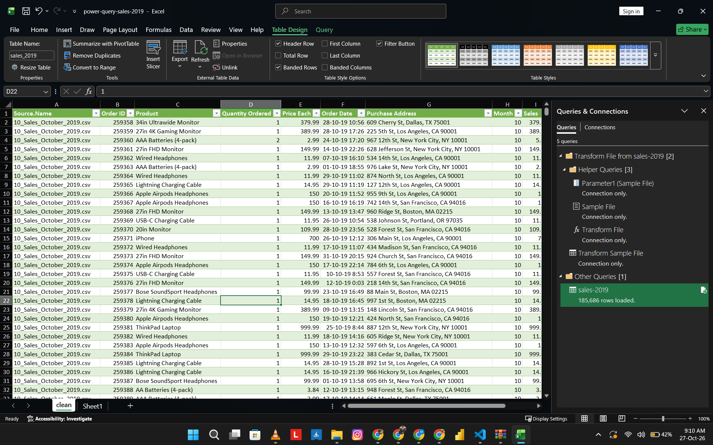
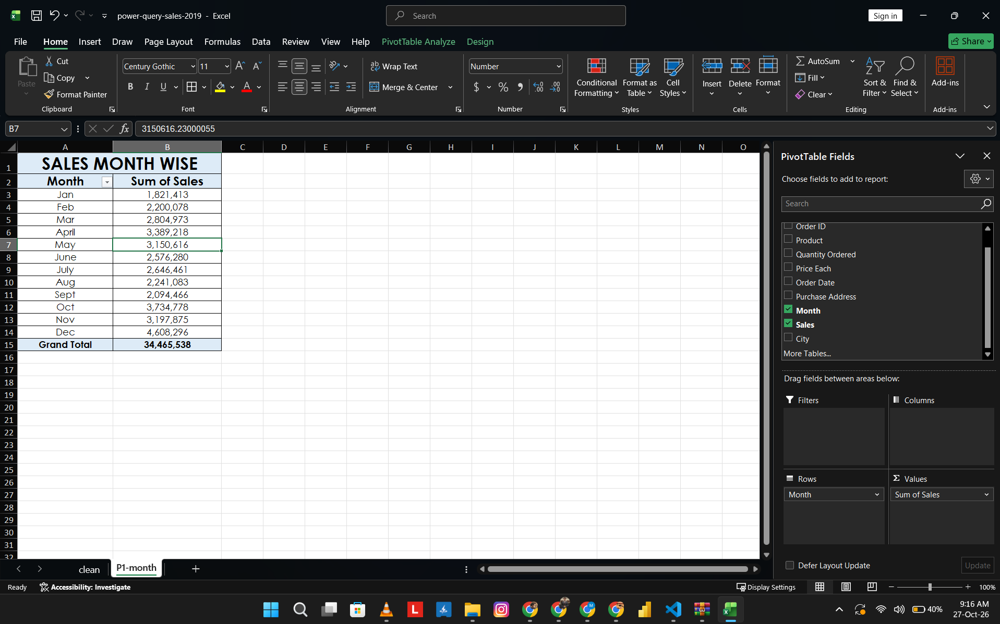
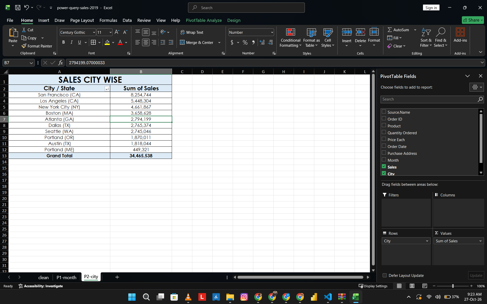

# Task 05: Combine and clean multiple files with Power Query

## Question
Which months and cities drove the most sales in 2019, after combining 12 monthly files into one clean table?

## Source
Sales Product Data, 12 monthly CSV files for 2019 (Kaggle): <https://www.kaggle.com/datasets/sinjoysaha/sales-analysis-dataset/data?select=Sales-Analysis-Dataset>. The CSVs are not committed. The workbook `work/power-query-sales-2019.xlsx` holds the cleaned table and the pivots.

## Grain
One row is one product line on one order. An order can have several lines, so Order ID repeats: there are 178,437 distinct Order IDs in 185,686 rows.

## Quality problems
| Step | Rows | Removed |
|---|---|---|
| 12 files combined | 186,850 | |
| Repeated header rows (Order ID errors) | 186,495 | 355 |
| Blank rows (empty Order ID) | 185,950 | 545 |
| Exact duplicate rows (all 7 columns) | 185,686 | 264 |

- Total removed: 1,164 rows. Rows loaded to the `clean` sheet: 185,686.
- Quantity Ordered, Price Each and Order Date arrived untyped.
- Order Date is month/day/year text, so it needed the English (United States) locale to convert.
- Portland exists in Maine and Oregon, so the city key includes the state.

## Method
1. Data > Get Data > From Folder > Combine & Transform on the 12 CSVs.
2. Remove Errors on Order ID (the repeated header rows).
3. Filter out empty Order ID rows. Remove Blank Rows does not work here, because Source.Name is filled on every row.
4. Remove Duplicates across all 7 columns. Duplicates were not removed on Order ID, because one order can have several products.
5. Set types: Quantity Ordered as whole number, Price Each as decimal, Order Date as date/time with the English (United States) locale.
6. Add Month (1 to 12), Sales (`[Quantity Ordered] * [Price Each]`) and City (city plus state, taken from Purchase Address).
7. Load to the `clean` sheet and build two PivotTables, `P1-month` and `P2-city`.

## Findings
- Total sales for the year: 34,465,538.
- December is the highest month at 4,608,296 (13.4% of the year), 2.5 times January, the lowest month at 1,821,413.
- October to December together are 11,540,949 (33.5% of the year).
- San Francisco (CA) is the top city at 8,254,744 (24.0%). San Francisco, Los Angeles and New York City together are 18,364,915 (53.3%).
- Portland (ME) is the lowest city at 449,321. Portland (OR) is 1,870,011.

## What the data can't answer
- It holds sales only (quantity × price). There is no cost or profit, so it cannot say which month or city earned the most.
- It covers one year, so it cannot show whether December is a repeating peak.
- The 264 removed rows were exact copies. The data cannot show whether they were entry errors or real repeat lines.
- City comes from the address text and was not checked against a list of places.

## Screenshots

### 01 Source files
The 12 monthly CSV files in the raw folder.

### 02 Combined raw data
The combined table before cleaning: 186,850 rows and 355 errors in Order ID.

### 03 Applied steps
Every cleaning step in Power Query, in order.

### 04 Row counts
The loaded table: 185,686 rows.

### 05 Sales by month
Pivot of total sales by month.

### 06 Sales by city
Pivot of total sales by city.

