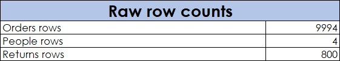
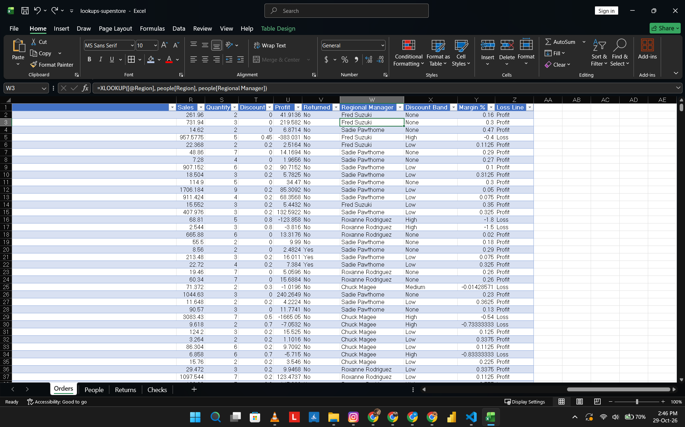
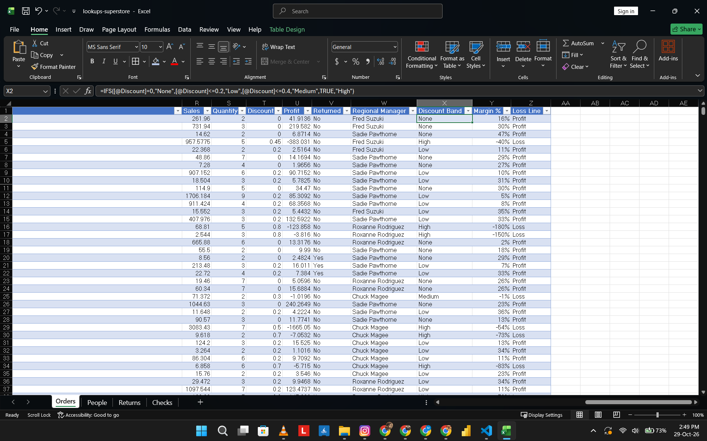
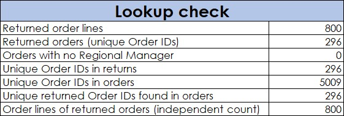
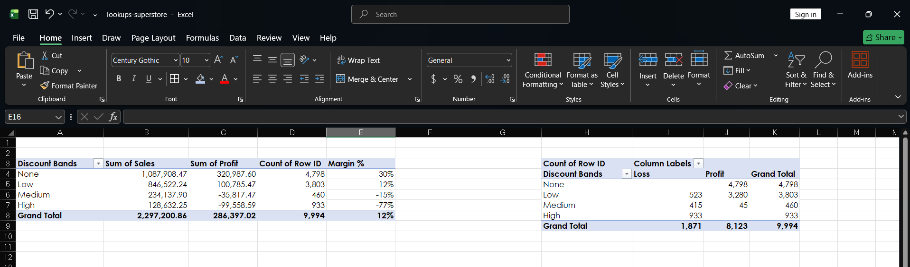
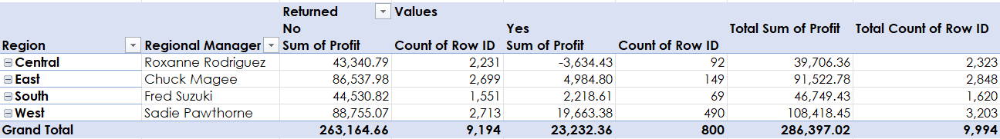

# Task 06: Lookups and conditional logic (Sample Superstore)

Phase 1 (Excel), mini task 6 of 31.

## Question
Do heavily discounted lines lose money, and which region performs worst once returned orders are flagged?

## Source
Sample Superstore (Tableau sample data, from Kaggle). The workbook has three sheets: Orders (9,994 rows), People (4 rows) and Returns (800 rows). The original file was .xls; I saved a working copy as `work/lookups-superstore.xlsx` and kept the three original sheets as raw data.

## Grain
One row per product line per order. Orders has 9,994 lines and 5,009 unique Order IDs, so one order can hold several products.

## Quality problems
- Returns has 800 rows but only 296 unique Order IDs. The rows are most likely one per order line, but I did not prove this.
- All 296 returned Order IDs exist in Orders.
- Every row in Orders matched a Regional Manager (0 unmatched).
- Duplicate Order IDs in Orders are expected, because the grain is one line per product.

## Method
1. Converted the three sheets to tables: `orders`, `people`, `returns`.
2. Added five columns to `orders`:
   - Returned: `XLOOKUP` on Order ID against `returns`, default "No".
   - Regional Manager: `XLOOKUP` on Region against `people`.
   - Discount Band: `IFS` on Discount: None (0), Low (up to 0.2), Medium (above 0.2 up to 0.4), High (above 0.4).
   - Margin %: `IFERROR(Profit/Sales,0)`.
   - Loss Line: `IF(Profit<0,"Loss","Profit")`.
3. Built a `Checks` sheet to verify the lookup: row counts, unique Order IDs, an independent count of the lines belonging to returned orders (800, same as the Returned = Yes count), and unmatched managers (0).
4. Built three pivots on one sheet:
   - P1-discount: Sales, Profit and line count per Discount Band. Margin % is calculated beside the pivot as Profit / Sales per row, not summed.
   - P1b: line count per Discount Band by Loss Line. Empty cells mean zero lines.
   - P2-returns: Profit and line count per Region and Regional Manager, split by Returned.

## Findings
Total: sales 2,297,200.86, profit 286,397.02, margin 12%, 9,994 lines.

| Discount band | Lines | Profit | Margin | Loss lines |
|---|---|---|---|---|
| None | 4,798 | 320,987.60 | 30% | 0 |
| Low | 3,803 | 100,785.47 | 12% | 523 |
| Medium | 460 | -35,817.47 | -15% | 415 |
| High | 933 | -99,558.59 | -77% | 933 |

- 1,871 of 9,994 lines lose money. None of them is in the None band.
- Medium and High together are 1,393 lines (13.9% of all lines) and have a combined profit of -135,376.06. The High band alone is -99,558.59, equal to 34.8% of the net profit.
- 296 orders were returned, covering 800 lines (8.0% of lines). Their profit is 23,232.36 (8.1% of total profit), about 29.04 per line against 28.62 on the other 9,194 lines.
- Central (Roxanne Rodriguez) is the weakest region: lowest total profit (39,706.36) and lowest profit per line (about 17, against 29 to 34 in the other regions). It is also the only region where returned lines have a negative profit (-3,634.43 on 92 lines).

## What the data can't answer
- Which item in a returned order was returned. Returns holds only the Order ID, so the flag marks every line of a returned order.
- How much was refunded. The profit on returned lines is the profit as recorded, not the cost of the return.
- Whether discount caused the losses. Discount depends on product and category, which I did not test.
- Why Central is weaker than the other regions.

## Screenshots

### 01 Raw row counts
Row counts of the three raw sheets: Orders 9,994, People 4, Returns 800.

### 02 Lookup formulas
The Returned and Regional Manager columns, with the XLOOKUP formula in the formula bar.

### 03 Conditional formulas
The Discount Band column with the IFS formula in the formula bar, next to Margin % and Loss Line.

### 04 Lookup check
Checks that confirm the lookup: 296 returned orders, all found in Orders, covering 800 lines.

### 05 Discount pivots
Sales, profit, line count and margin per discount band, with loss lines per band.

### 06 Returns pivot
Profit and line count per region and regional manager, split by returned and not returned.

