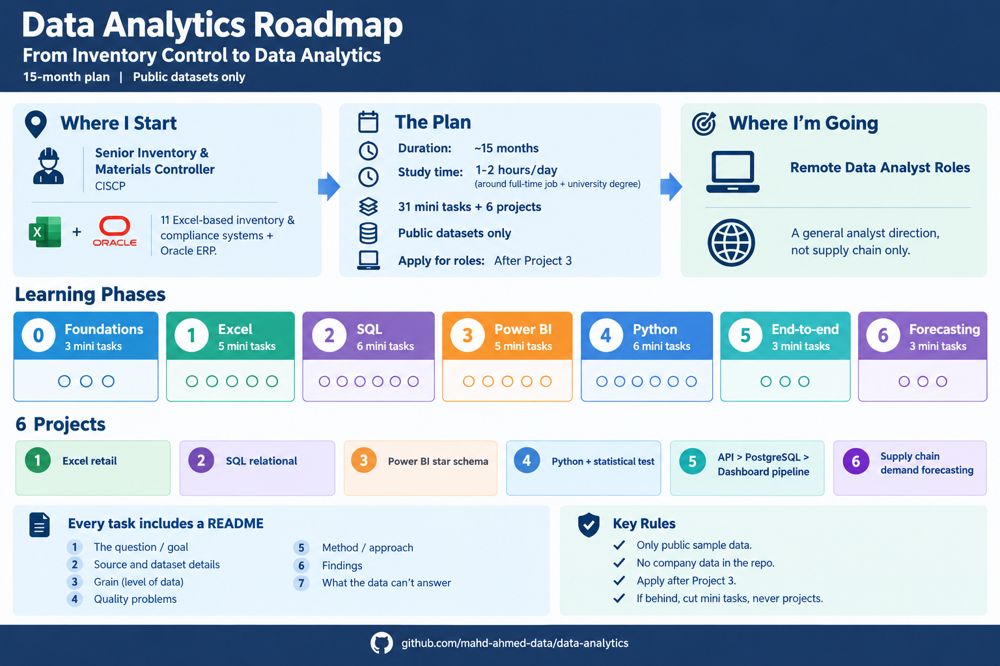

# Data Analytics Roadmap

From inventory control to remote data analyst roles. Fixed plan, about 15 months, 1-2 hours a day, around a full-time job and a university degree.

## Starting point

Senior Inventory & Materials Controller (CISCP). Built 11 Excel-based inventory and compliance systems that run alongside Oracle ERP.

## Target

Remote data analyst roles, general analyst direction, not supply chain only. I start applying after Project 3.

## Rules

- Public sample datasets only
- No company data in this repo
- Every task has a README with these headings: Question, Source, Grain, Quality problems, Method, Findings, What the data can't answer
- If I fall behind, I cut mini tasks, never projects

## Learning phases: 31 mini tasks

| Phase | Topic | Mini tasks |
|---|---|---|
| 0 | Foundations | 3 |
| 1 | Excel | 5 |
| 2 | SQL | 6 |
| 3 | Power BI | 5 |
| 4 | Python | 6 |
| 5 | End-to-end | 3 |
| 6 | Forecasting | 3 |

Phase 0 exit test: on an unseen CSV, in about 60 minutes, state the grain, list the quality problems, write three questions the data can answer and one it cannot.

## Projects: 6

1. Excel retail analysis
2. SQL relational database
3. Power BI star schema
4. Python analysis with a statistical test
5. API to PostgreSQL to dashboard pipeline
6. Supply chain demand forecasting